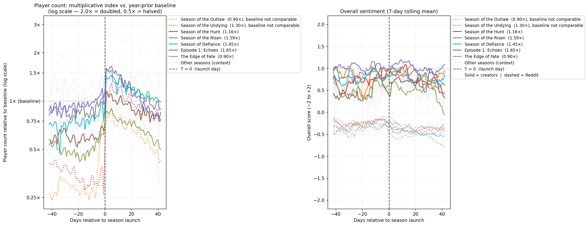
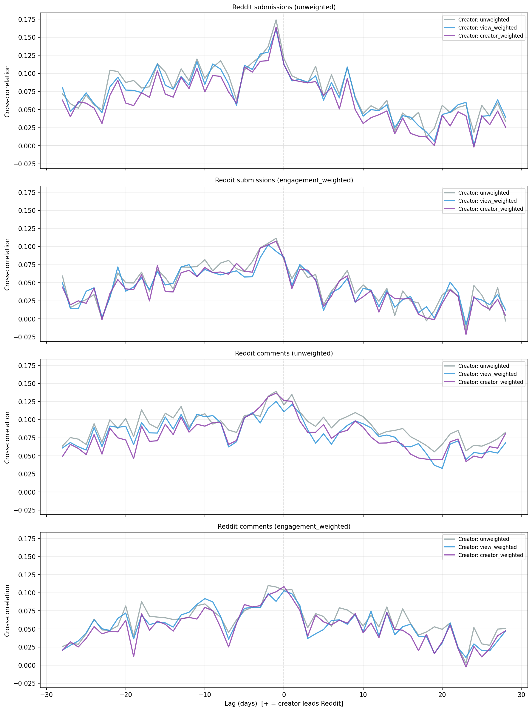
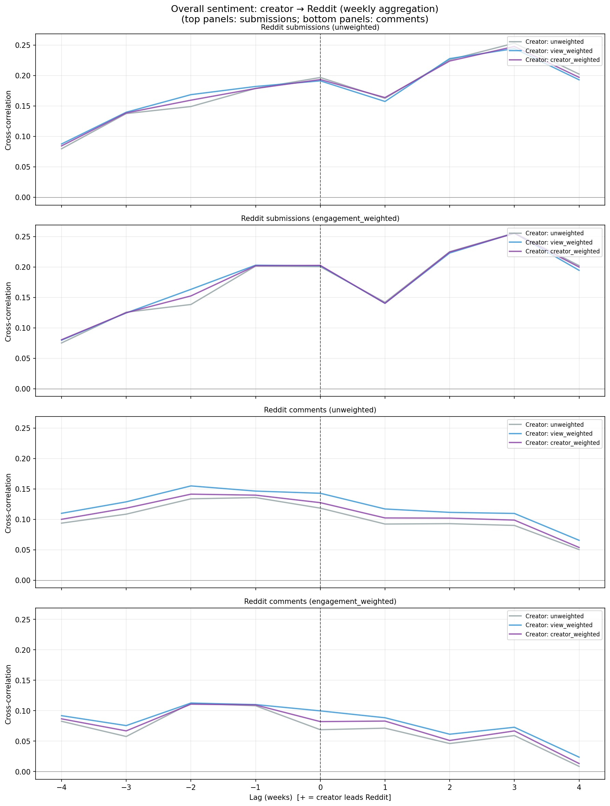
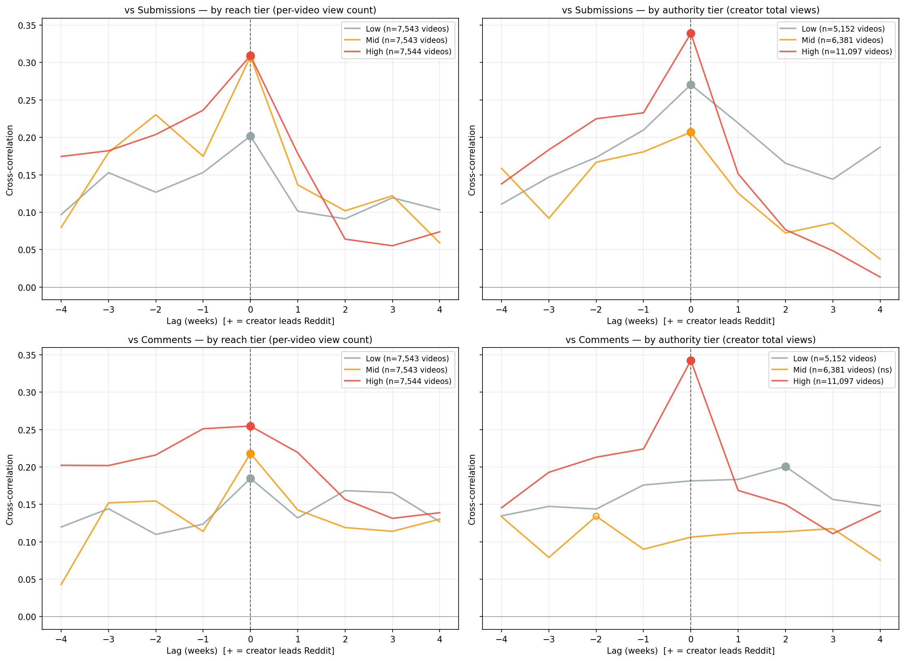
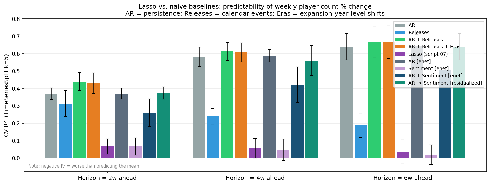
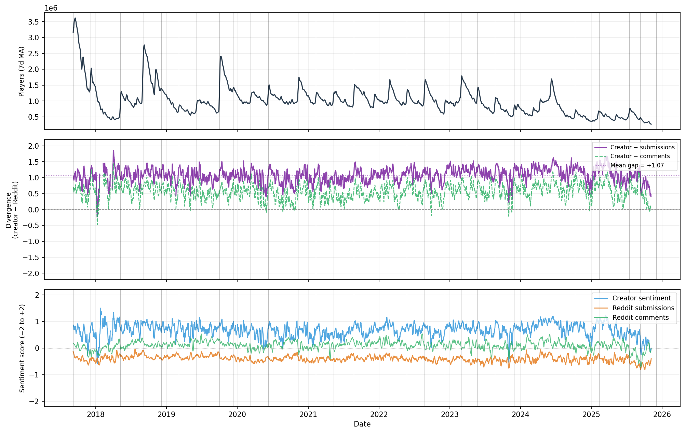

# Creators Rarely Lead: Creator and Community Sentiment in Five Live-Service Games

**Acea Sands** and **Levi Sands**, Independent Researchers

## Abstract

Studios cultivate content creators through creator programs, early access, and coordinated launch coverage, and a common conception holds that prominent creators shape how communities feel about a game. Elite influence theory predicts this of opinion leaders. We ask whether creators act as such elites, testing whether creator sentiment leads community sentiment (H1), whether that lead scales with reach and authority (H2), and whether creator engagement signals lead player-count declines (H3). We study five live-service games (Destiny 2, Warframe, Counter-Strike, Dota 2, Dead by Daylight): 47,891 YouTube videos, 667,445 Reddit submissions, 3.95 million comments, and 8–11 years of player counts, with sentiment scored by an LLM validated against human ratings in Destiny 2 (r = 0.82). The planned daily tests disagree: no creator-leading cross-correlation peak survives family-wise correction, while creator → community Granger tests survive it in Destiny 2 and Warframe, with small single-lag gains (ΔR² ≤ 0.011). Requiring both, a rule set after the results, no game meets H1. In a weekly test added later, Warframe's creators lead submissions by three weeks (r = 0.25; Holm p = 0.036 across 20 cells); the lead is slow, absent from comments, and no stronger among high-reach or high-authority creators. In Destiny 2, creator and community sentiment move together within the same week (r = 0.41). Counter-Strike and Dota 2 show no hypothesis-consistent lead, and Dead by Daylight only a fragile candidate. H2 is unsupported and H3 does not replicate; sentiment never improves player-count prediction beyond persistence (15 game × horizon tests). As scored by the model, creators are persistently more positive than their subreddits (+0.69 to +1.14 points), though human ratings confirm the direction only marginally.

## 1. Introduction

Live-service game studios engage content creators in visible ways. They run creator programs, invite prominent YouTubers and streamers to playtests and early access, and coordinate coverage around launches. Digital Extremes' invite-only Warframe Creator Program supplies selected creators with new in-game items to showcase, giveaway currency, and asset kits (Digital Extremes, n.d.). Behaviour Interactive's Fog Whisperers program gives Dead by Daylight broadcasters additional information on new content, in-game currency, and codes for their viewers (Behaviour Interactive, 2019). Part of the value is reach, but a common conception holds that creators also shape opinion: what prominent creators say about a game moves how its community feels and, eventually, whether people keep playing. Studios treat sentiment as an outcome of this work. Supercell reports using dashboards to track how creator performance connects "to player behaviour and sentiment" and attributes "increased positive sentiment" in 2024 partly to its creator program (Crane, 2025). To our knowledge the conception has not been tested at ecosystem scale. Our design cannot evaluate reach; it can evaluate whether creators' expressed sentiment moves *before* their communities' sentiment and their games' player counts.

Elite influence theory makes the claim testable. From the two-step flow model (Katz & Lazarsfeld, 1955) to Zaller's (1992) account of elite discourse, the theory predicts that where interpretation requires expertise, a few high-visibility opinion leaders shape the perceptions of a broader public. Live-service games suit the theory well: the elite is well defined (full-time creators with large audiences), the public is observable at scale (game subreddits), patch notes and balance changes reward interpretive expertise, and player counts give a daily behavioral outcome. The open question is whether creators function as elites in the theory's sense.

We test three hypotheses in five ecosystems spanning four genres and four publishers. Our answer is mostly no. Creator and community sentiment move together, but creators rarely move first. On the daily tests our analysis plan fixed, no creator-leading cross-correlation peak survives correction, while Granger tests survive correction in Destiny 2 and Warframe; no game shows both. In Destiny 2, the best-measured case, the two series are tightly coupled within the same week. Warframe is the exception: in a secondary weekly test its creators lead subreddit submissions by about three weeks, but without the other properties elite influence predicts. Reach and authority tiers show no gradient, creator engagement signals produce one slow Destiny 2 association that no other game replicates, and no sentiment series adds predictive information about player counts beyond the player series' own history.

To make the null interpretable, we pair the headline tests with a simulation-based power analysis, bootstrap bounds on effect size, an autocorrelation-aware baseline, family-wise correction, and replication across five ecosystems, and we run the same trend, release, and season-phase diagnostics on every game, not only where a positive appeared. We also report the one level difference that replicates: on the model's measure, creators score persistently higher than their communities.

## 2. Background

**Elite influence.** The two-step flow model (Lazarsfeld, Berelson, & Gaudet, 1944; Katz & Lazarsfeld, 1955) proposed that media effects on mass opinion pass through opinion leaders who attend closely to media, interpret it, and relay it to less attentive others. Zaller (1992) generalized the mechanism: opinions form from the balance of elite discourse a person receives, so when elites shift, attentive publics shift first and the broader public follows. Two predictions matter here. Opinion-leader sentiment should move *before* mass sentiment (temporal precedence), and the effect should be strongest for the most visible and credible elites (dose–response by standing). Both are testable with time series, and both share a failure mode: a common stimulus that moves elite and mass at once. The mapping onto creator ecosystems is not one-to-one: large YouTube channels broadcast far beyond any personal network, so they resemble the model's *media* as much as its opinion leaders.

**Opinion leadership online.** Large-scale trace data complicate the picture of concentrated influence. Watts and Dodds (2007) showed in simulation that cascades depend more on network susceptibility than on exceptional influentials. Follower counts predict realized influence poorly (Cha et al., 2010), and individual influence is highly variable even where high-follower users have larger average cascades (Bakshy et al., 2011). Dubois and Gaffney (2014) distinguish visibility-based from conversation-based leadership, a distinction our reach and authority tiers mirror. The influencer-marketing literature mostly presumes influence and studies engagement, attitudes, or purchase intent (Hudders, De Jans, & De Veirman, 2021). The closest behavioral evidence for games comes from Twitch: a game's concurrent players respond to its live-stream viewership with an elasticity of about 0.027, an effect that dissipates within hours (Huang & Morozov, 2025). Our daily and weekly design cannot see effects that short. Tests of whether influencer sentiment precedes audience sentiment at community scale remain scarce.

**Creators in game ecosystems.** Game streaming and video creation is a professional field with its own platform economics (Taylor, 2018; Johnson & Woodcock, 2019), and audiences watch for information about games, for entertainment, and for social connection (Sjöblom & Hamari, 2017). Games scholarship has long treated the material surrounding games as paratext (Consalvo, 2007) but has rarely tested creators' assumed opinion-shaping role quantitatively.

**LLM measurement.** Dictionary sentiment tools such as VADER (Hutto & Gilbert, 2014) handle gaming discourse poorly: vernacular inverts valence ("busted" is often praise) and sarcasm is common. Instruction-tuned LLMs match or exceed crowd annotation on some social-text tasks (Gilardi, Alizadeh, & Kubli, 2023; Törnberg, 2025), but their accuracy varies by task, prompt, and dataset (Reiss, 2023), so each application needs its own validation against human labels (Pangakis, Wolken, & Fasching, 2023). We treat the LLM as such an instrument (§4.3).

## 3. Hypotheses

- **H1 (opinion formation).** Creator overall sentiment leads community overall sentiment: the creator–community cross-correlation peaks at a positive (creator-first) lag, and creator sentiment Granger-predicts community sentiment.
- **H2 (heterogeneity).** The H1 lead is strongest in the highest tier of reach (per-video audience) and authority (channel size).
- **H3 (behavior).** Creator engagement indicators (still playing, burned out, would recommend) lead player-count declines. Creators could forecast churn even if they do not shape opinion.

A secondary version of H1 holds that influence concentrates on topics that need interpretive expertise, so topic-level creator sentiment should lead community sentiment on those topics.

The study was not pre-registered. A written analysis plan, drafted after exploratory work on Destiny 2 and before the tests reported here were run, fixes the hypotheses and the primary test: daily creator → community cross-correlation at lags of 0–28 days, Granger tests, a permutation null, and an autoregressive baseline. The plan was then extended with robustness analyses, and three of those extensions decide the H1 verdict. First, a weekly version of the H1 test was added after the weekly H3 results; we treat the daily tests as planned and the weekly test as secondary. Second, the plan lists cross-correlation and Granger tests without saying how to combine them; we require both. Third, the multiple-testing families (§5) were defined afterward. Appendix A quotes the plan and lists the main departures from it. H1–H3 are confirmatory; everything else is labeled exploratory. Our defense against forking paths is uniformity: the same diagnostic battery runs in every game regardless of its first result.

## 4. Data

### 4.1 Games and corpora

We required public daily player counts and a mature, opinion-forward creator ecosystem. Destiny 2 is the primary case: it has the densest creator series (19 creators, median 49 videos per week; Table 1), an all-platform player series, and a human validation set. The other four replicate across genres (cooperative looter-shooter: Destiny 2 and Warframe; tactical FPS: Counter-Strike; MOBA: Dota 2; asymmetric horror: Dead by Daylight) and publishers (Bungie, Digital Extremes, Valve, Behaviour Interactive).

**Table 1. Corpus after eligibility, game-relevance, and launch-date filtering.**

| Game | Creators | Videos | Submissions | Comments | Weeks |
|------|---------:|-------:|------------:|---------:|------:|
| Destiny 2 | 19 | 22,630 | 235,623 | 1,392,085 | 435 |
| Warframe | 9 | 7,629 | 104,654 | 593,145 | 549 |
| Counter-Strike | 6 | 3,622 | 75,507 | 609,709 | 545 |
| Dota 2 | 7 | 7,433 | 116,832 | 721,791 | 503 |
| Dead by Daylight | 8 | 6,577 | 134,829 | 637,582 | 484 |

*Reddit coverage: Destiny 2 from its 2017-09-06 launch, Dead by Daylight from its 2016-06-14 launch, the other three from 2015; all to 2025-12. Creator coverage runs to 2026-02. "Weeks" counts weeks with both creator and submission sentiment.*

**Creators.** For each game we hand-curated channels with sustained analysis, review, and state-of-the-game coverage. Transcripts were collected with yt-dlp and re-punctuated. Collection was capped at about 2,000 videos per channel, which truncates the earliest history of the most prolific channels (§8).

**Reddit.** Submissions and comments from each game's main subreddit(s) came from per-subreddit Pushshift dumps (Baumgartner et al., 2020) distributed through Academic Torrents. Text was filtered for length and game-relevant keywords, and a random 20% of submissions was processed. Comments are the top-level replies to sampled submissions.

**Player counts.** For Warframe, Counter-Strike, Dota 2, and Dead by Daylight we use daily Steam player counts from SteamDB. For Destiny 2 we use an all-platform series of daily unique players from popularity.report, derived from public post-game activity reports; outside release weeks, Destiny 2's SteamDB counts track it closely. Destiny 2 moved to Steam, went free-to-play, and added cross-save on 2019-10-01; the all-platform series spans that date without a measurement break, but the player population changes there. Destiny 2's and Dead by Daylight's series begin at launch, so Destiny 1-era and pre-release discussion on Destiny 2's subreddit is excluded. A per-game release calendar supports release-aware analyses.

### 4.2 LLM pipeline

**[Models: confirm the model and vLLM version for each game; Warframe may have been scored with a different model.]** All text was processed by Qwen3-30B-A3B-Instruct-2507 (Yang et al., 2025) in a 4-bit AWQ quantization (`cyankiwi/Qwen3-30B-A3B-Instruct-2507-AWQ-4bit`), served with vLLM (Kwon et al., 2023) at temperature 0.3. A first pass detects which of a game-specific set of topics a text discusses. A second pass extracts sentiment for the detected topics alongside core fields: overall sentiment toward the game's current state, nine sentiment dimensions, future outlook, emotional tone, three creator engagement fields, the game the text is about, and the model's confidence. Comments use a lighter single-pass prompt that yields an overall score. Each game has its own prompt and topic vocabulary (233 topics in 11 categories across the five games).

Sentiment is scored from −2 to +2. "Unclear" is treated as missing, never as 0. Topic fields are populated only when a topic is detected, so a missing topic field means "not discussed", not "neutral". For all three engagement fields, higher is healthier (*burned out* is coded so that higher means less burned out).

### 4.3 Validation

A human rater, blind to model output, labeled a Destiny 2 test set of 75 items (25 each of creator transcripts, submissions, and comments, stratified by year; Table 2).

**Table 2. Human–LLM agreement (Destiny 2).**

| Field | Metric | Value | n |
|-------|--------|-------|---|
| Sentiment score | Pearson r / MAE / within-1 | 0.82 / 0.32 / 0.99 | 75 |
| Optimism | Pearson r / MAE | 0.84 / 0.45 | 49 |
| Emotional tone (valence-collapsed) | Cohen's κ | 0.78 | 70 |
| Burned out; would recommend | Cohen's κ | 1.0 | 25 |
| Still playing | Raw agreement | 25/25 (κ undefined) | 25 |

*All 25 creator items were "still playing: yes" for both model and rater, so that field's accuracy on negative cases is untested.*

Sentiment agreement is comparable to the split-half reliability of crowdsourced emotion-intensity annotation (r ≈ 0.80–0.88; Mohammad & Bravo-Marquez, 2017), although that figure compares aggregated annotations and ours compares the model with one rater. Topic fields were not separately validated, so topic-level results are exploratory, and measurement quality in the other four games is assumed rather than verified.

## 5. Methods

**Aggregation and preprocessing.** Creator sentiment is aggregated daily and weekly under three schemes: per-video unweighted (output volume), view-weighted (reach), and creator-size-weighted (authority). Reddit sentiment uses two: unweighted (breadth) and engagement-weighted (salience). The primary test uses unweighted series and is repeated under all six combinations. Daily series are deseasonalized by regressing out day-of-week dummies. Release effects are handled by excluding weeks within ±14 or ±28 days of a release and by residualizing weekly series on weeks since the last release (a season-phase control). Secular trends are handled by repeating weekly tests on linearly detrended and first-differenced series.

**Lead/lag estimation and the noise gate.** The primary estimator is the normalized cross-correlation of creator and community series at lags of ±28 days or ±4 weeks (±12 weeks in some sensitivity checks); positive lag means creators lead. Both series sit on a regular calendar index, so lag k always means k days or weeks, including in sparse series. A peak chosen as the largest |r| across the window (57 daily or 9 weekly lags) is inflated by the search. Every reported peak is therefore *gated* against a max-statistic null: we circularly shift the creator series, which preserves its autocorrelation and gaps, record the largest |r| across the same lag window for each shift, and accept the observed peak only if it exceeds the 95th percentile. Direction labels a gated peak but never selects it.

**Multiple testing.** The H1 cross-correlation tests form one family of 20 cells (5 games × 2 community targets × the planned daily and secondary weekly tests). For each cell we compute exact circular-shift p-values over every distinct shift for two statistics: the gate statistic (largest |r| across the window) and a directional one (largest r at creator-leading lags), which is the closer match to the plan's window of 0–28 days. We Holm-adjust (Holm, 1979) across all 20 cells and, as a weaker view, within each game. Exact p-values have a floor of 1/(number of shifts + 1), about 0.002 for weekly series, so a weekly cell's Holm-adjusted p across the 20 cells cannot fall below about 0.04. The planned daily Granger tests form a second family (5 games × 2 targets); each block's p is its minimum over lag orders, Bonferroni-corrected for the number of orders, then Holm-adjusted. Outside these families, counts of gated cells are descriptive.

**Precedence tests.** Granger tests (Granger, 1969) add lags 1..L (L ≤ 14 days) of one series to an autoregression of the other. They are run in both directions and reported with the sign of the added coefficients, since the F-test is unsigned. Single-lag AR baselines compare AR(p) with AR(p) plus creator sentiment at lag h on identical rows, choosing p by AIC, and report the coefficient, ΔR², and ΔBIC. A low-order Granger model controls only a few lags of the target's own history, while the AR baseline controls the AIC-selected order. Lags are built on the calendar index, so in sparse games the usable sample shrinks as lag order grows (Counter-Strike supports only lags 1–4).

**Heterogeneity.** Reach tiers are per-video view-count terciles. Authority tiers are terciles over *creators* by total portfolio views. Because "authority" is contestable, the gradient is re-tested under four definitions: total views, mean views per video, peak single-video views, and recency-corrected views.

**Prediction.** An elastic net (Zou & Hastie, 2005) over 184–414 weekly sentiment features per game predicts the winsorized percent change in weekly players 2, 4, and 6 weeks ahead, scored by five-fold time-series cross-validation. The decisive comparison is nested, on identical rows with one estimator: persistence only (lagged player change), sentiment only, both, and a residualized arm that fits persistence first and then asks whether sentiment explains the residuals, with both stages inside each fold.

**Power and bounds.** The gate controls false positives but says nothing about detection, so we measure power directly. For each game, target, and granularity we take the real creator series, shift it circularly with its gaps in place (which breaks any real relationship), and plant it into the real community series at lag L (1, 3, 7, 14 days; 1–4 weeks) with a scaled correlation ρ. A replicate counts as detected if there is a gated peak at a creator-leading lag with positive sign (200 replicates per cell). We report the minimum detectable effect (MDE), the smallest ρ caught 80% of the time, and power at ρ = 0.10, Cohen's (1988) conventional "small" correlation. We adopted ρ = 0.10 as the smallest effect of interest after seeing the results, to give "well powered" a fixed meaning, not because smaller effects are unimportant (Funder & Ozer, 2019). Separately, 95% circular block-bootstrap intervals (Politis & Romano, 1992) bound the correlation at lags fixed in advance: lag 0 for H1/H2 and +1 week for H3.

## 6. Results

### 6.1 Release dynamics

Live-service player counts follow a sawtooth: each expansion or season produces a sharp revival that decays toward a floor (Figure 1). Release-success rankings computed against a same-date prior-year baseline are stable across window widths (Spearman ρ = 0.92–0.99 against the 6-week reference) but agree only weakly with rankings against a short pre-launch baseline (ρ = 0.23 in Destiny 2). The outcome studios care about is dominated by the publisher's own release calendar, a common stimulus every analysis below has to respect.

*Figure 1. Destiny 2 releases, ±6 weeks around launch day. Left: player count as a ratio of the same-date prior-year baseline (log scale; 1.0 = baseline), expansions highlighted against the other seasons in grey. Right: 7-day mean sentiment of creators (solid) and submissions (dashed). Two seasons are dotted because their baselines are not comparable: Undying's predates the 2019-10-01 free-to-play change, and Outlaw's falls on Destiny 2's launch weeks.*

### 6.2 H1: creators rarely lead (confirmatory)

**Planned daily tests.** The plan's three daily tests (cross-correlation, Granger, AR baseline) disagree (Table A1). Corrected across the 20 cross-correlation cells, no game shows a daily creator-leading peak on either statistic. The directional statistic comes closest in Destiny 2 comments (Holm p = 0.14; r = 0.13 at +1 day) and Warframe submissions (0.30; r = 0.12 at +22 days); these two are also the only daily directional values below 0.05 when corrected within game (0.029 and 0.049). Corrected across the ten daily Granger cells, three creator → community blocks survive: Destiny 2 submissions (p = 0.012), Destiny 2 comments (0.0003), and Warframe submissions (0.012). The single-lag AR baseline (uncorrected) finds small creator-first terms in Warframe submissions (two days, ΔR² = 0.011) and Destiny 2 comments (one day, 0.002), none in Destiny 2 submissions, and in Dota 2 comments a one-day positive term followed by a two-day negative one. Requiring both a creator-leading cross-correlation peak and Granger precedence, no game meets H1 on the planned tests; on Granger alone, Destiny 2 and Warframe would.

**Destiny 2.** Daily, the creator–community cross-correlation peaks at −1 day (r = 0.17 against submissions, 0.14 against comments; Figure 2). Precedence tests show coupling in both directions (Table 3). Creator sentiment Granger-predicts the community series at short lag orders, with small positive coefficients (block sums +0.03 to +0.05), and community sentiment Granger-predicts creator sentiment at every one of 14 lag orders for both targets. Granger significance between two noisy measures of a shared, persistent signal is not by itself evidence of direction, in either direction. Controlling the AIC-selected order of the target's own history (12 days for submissions), creator sentiment adds nothing for submissions at any tested lag (all p ≥ 0.10); for comments a small one-day component survives (coefficient +0.025, ΔR² = 0.002, p = 0.002).

Weekly, creator and community sentiment are tightly coupled at lag 0 (Table 4). The creator–submissions correlation is r = 0.41, and it holds under detrending (0.44), first differences (0.25), release-window exclusion (0.37–0.39), and the season-phase control (0.42), with the peak at lag 0 every time. Against comments it is r = 0.30–0.34 at lag 0 under all six weighting combinations. Weekly, community → creator Granger is significant at all four lags for both targets, creator → community at none for submissions (Table 4) and at lag 1 for comments, and no single-lag creator term is significant for either target (p ≥ 0.13). The topic fields lean away from H1 as well: 28% of Destiny 2's 97 fields peak at a creator-leading lag weekly, against a permutation null of 45% (lower-tail p ≈ 0.01).

*Figure 2. Destiny 2 creator → community cross-correlation of overall sentiment, daily ±28 days. Panels, top to bottom: submissions and comments, each unweighted and engagement-weighted; lines are creator weighting schemes. Positive lag = creators lead. Every curve peaks between −2 days and 0. For the unweighted series the 95% noise gate is |r| = 0.09 (submissions) and 0.10 (comments).*

**Counter-Strike and Dota 2.** Neither shows a creator lead. Counter-Strike's largest overall correlation is a borderline lag-0 weekly co-movement (r = 0.12), and its Granger tests are significant only at lag 1 for submissions. Dota 2's daily comments block is significant at 10 of 14 orders but has no net direction: at every order the lag-1 coefficient is positive and the lag-2 coefficient negative.

**Table 3. Daily Granger tests in both directions (significant lag orders out of those estimable; sign of creator coefficient sums for creator → community).**

| Game | Creator → submissions | Creator → comments | Submissions → creator | Comments → creator |
|------|------|------|------|------|
| Destiny 2 | 5/14 (lags 1–4, 8), + | 7/14 (lags 1–7), + | 14/14 | 14/14 |
| Warframe | 4/14 (lags 1–4), + | 0/14 | 0/14 | 3/14 (lags 1–3) |
| Counter-Strike | 1/4 (lag 1), + | 0/4 | 0/3 | 1/3 (lag 1) |
| Dota 2 | 0/14 | 10/14; lag-1 +, lag-2 − at every order | 0/14 | 0/14 |
| Dead by Daylight | 2/14 (lags 2–3), + | 0/14 | 0/14 | 1/14 (lag 1) |

*Lags are calendar days. Counter-Strike's sparse creator series supports only lag orders 1–4 (1–3 in reverse).*

**Topic fields.** The topic-level test covers 97 fields in Destiny 2 and fewer in the sparser games. No median field lag is more than a week from zero. Across the ten game × granularity cells, four creator-leading fractions sit above their permutation null, five below, and one at it; none departs significantly in the hypothesis direction. Of 36 topic-category tests, one leans creator-first at nominal significance (Warframe's Progression & Economy fields, one-sided p ≈ 0.02), about what chance predicts, so the expertise-concentration version of H1 also fails.

**AR baselines and robustness.** Across all 80 single-lag cells (5 games × 2 targets × 2 granularities × 4 lags), adding creator sentiment raises BIC in 74; the six exceptions are Destiny 2's one-day comments cell and five Warframe cells. Outside Warframe, no significant cell explains more than about 1% additional variance. Reweighting Reddit by engagement keeps Destiny 2's overall peak at −1 day and lag 0 weeks, while individual topic fields' peak lags scramble (49 of 97 move by more than a week), which a real field-level lead would not do. Under 3- to 14-day smoothing every game's median field lag stays within a few days of zero, and the three Destiny 2 expansion-era peaks that clear the gate sit at lag 0 or −1 day (elsewhere 5 of 65 era cells clear, one creator-leading: Dota 2 in 2019). Dropping creator subgroups, low-confidence outputs, or submissions that link to YouTube leaves every game's H1 verdict in place (§6.11).

### 6.3 The Warframe exception

On the planned daily tests Warframe resembles Destiny 2: a Granger block without a corrected cross-correlation lead. Its daily peak is at +22 days (r = 0.12; Holm p = 0.41 on the gate statistic), on a curve with no distinct peak across positive lags. Creator → submissions Granger is significant at lags 1–4 with positive coefficient sums (+0.10 to +0.26), and submissions → creator is null at all 14 orders. The AR baseline finds creator terms for submissions at two days (coefficient +0.18, ΔR² = 0.011, p = 0.0009) and 14 days (p = 0.007) but not at one or seven (p = 0.15), and for comments only at 14 days (ΔR² = 0.004).

The secondary weekly test is where Warframe shows a cross-correlation lead. Its weekly creator–submissions correlation peaks at +3 weeks (r = 0.25), with +2 weeks close behind, under every weighting combination (Figure 3). It is the only one of the 20 cross-correlation cells that survives Holm correction across all 20: exact p = 0.0018, adjusted 0.036 (the smallest value attainable for this cell), and 0.007 within Warframe, for both statistics. The weekly AR-baseline coefficients for submissions are significant at lags 2–4, and BIC prefers the creator term at lags 2–3. Weekly creator → community Granger is significant at all four lags, and community → creator at lag 1. Every leave-one-group-out creator subset keeps the weekly lead (r = 0.20–0.33 at +2 to +3 weeks), as does the confidence filter.

The lead passes four further checks. It is not a trend artifact: the creator series has no trend, and detrending leaves the lead intact (r = 0.27 at +3 weeks). It is not a unit-root artifact: an augmented Dickey–Fuller test (Dickey & Fuller, 1979) rejects a unit root in the community series (p < 0.001; creator series p = 0.054). It is not the release weeks: excluding weeks within ±14 days of any update leaves a gated lead at +2 weeks (r = 0.25); at ±28 days the gated peak moves to lag 0 (r = 0.27), although r at +2 weeks is still 0.25. And it is not the season cycle: after residualizing both series on weeks since the last release, the peak stays at +3 weeks (r = 0.24, p = 0.002).

It fails the checks that would make it elite influence:

- **Not week-to-week transmission.** First-differenced, the association disappears (r = 0.04 at +2 weeks; differenced weekly Granger p ≥ 0.20). What leads is a slow component, and smoothing strengthens it (the daily peak stays at +15 to +22 days, r rising from 0.12 to 0.32 as the window widens to 14 days).
- **Not in comments.** No gated comment-layer peak sits at a creator-leading lag, creator → comments Granger is null at all 14 orders, and comments Granger-predict creator sentiment at lags 1–3.
- **Not topic-specific.** Warframe's topic fields show no overall creator-leading tendency (52% of 25 daily and 40% of 57 weekly fields peak at creator-leading lags, against nulls of about 50% and 45%).
- **No elite gradient.** Mid-authority creators lead more strongly than high-authority ones (r = 0.33 at +2 weeks vs. 0.24 at +3). Across the four authority definitions, 8 of 12 Warframe tier cells clear the gate, and the high tier is never the strongest.

The effect is modest: the largest single-lag gain in explained variance is 2.5%, and it has no downstream consequence we can detect (§6.6–6.7).

*Figure 3. Warframe weekly creator → community cross-correlation, ±4 weeks. Top: submissions; bottom: comments; lines are creator weighting schemes. Submissions peak at +3 weeks under every scheme; comments peak at community-leading lags (−1 to −2 weeks).*

### 6.4 The same diagnostics in every game

A trend can hide a lead as easily as create one, so the checks applied to Warframe run on the weekly H1 test in all five games and against both targets (Table 4).

**Table 4. Weekly H1 diagnostics, creator → submissions (gated peak lag in weeks, r; ns = no peak above the gate).**

| Game | Levels | Detrended | Differenced | ±14 d excluded | ±28 d excluded | Weekly Granger |
|------|------|------|------|------|------|------|
| Destiny 2 | 0, 0.41 | 0, 0.44 | 0, 0.25 | 0, 0.39 | 0, 0.37 | community → creator 4/4 in levels and detrended, 1/4 differenced; creator → community none |
| Warframe | **+3, 0.26** | **+3, 0.27** | ns | **+2, 0.25** | 0, 0.27 | creator → community 4/4 in levels and detrended, 0/4 differenced; reverse at lag 1 |
| Counter-Strike | ns | ns | ns | ns | ns | creator → community 1/4 differenced (negative sum) |
| Dota 2 | ns | ns | ns | +3, −0.19 | +3, −0.25 | none |
| Dead by Daylight | ns | **+1, 0.18** | ns | ns | ns | creator → community 4/4 detrended and differenced, positive; 1/4 in levels (sum ≈ 0) |

*Bold = gated at a creator-leading lag with positive r. Exclusion columns are levels. These cells use per-lag Pearson on the weekly index and can differ from the headline estimator by about 0.01. Against comments, no game has a gated creator-leading peak under any treatment.*

Across the 70 cells of this battery, 24 clear the gate. Eleven are Destiny 2's lag-0 cells. Only five are creator-leading with positive sign: four variants of Warframe's lead and one Dead by Daylight cell. **Dota 2** shows a *contrary* lead once release weeks are dropped: higher creator sentiment is followed three weeks later by lower submission sentiment. **Dead by Daylight** has a weak, trend-masked candidate. Its creator series trends down while submissions trend up. Detrended, a +1-week peak appears (r = 0.18, p = 0.035), and weekly creator → submissions Granger is significant at every order in detrended and differenced series. But the cross-correlation clears the gate only under detrending, not in differences, with release weeks excluded, or after the season-phase control, and detrended comments show the community leading by four weeks. The season-phase control leaves every other game's result where it was.

### 6.5 H2: no reach or authority gradient (confirmatory)

The tier battery (5 games × 2 granularities × 2 targets × reach and authority × 3 tiers) has 120 cells, of which 38 clear the gate. Most are Destiny 2's concurrent coupling showing through its tiers: 21 Destiny 2 cells clear, all but one at lag 0 or a community-leading lag. Eight survivors in all sit at a creator-leading lag with positive sign: four Warframe cells (§6.3), three small Dead by Daylight cells (r = 0.10–0.16), and one Destiny 2 low-authority cell. None is a high-tier cell outside Warframe. Across Destiny 2's four authority definitions, 11 of 12 tier cells clear the gate, all at lag 0, and no definition orders the tiers by authority: the strongest tier is high under two definitions, low under one, and middle under one. H2 is unsupported in all five games (Figure 4), though in the four secondary games, with one to three creators per tier, the test is also underpowered.

*Figure 4. Destiny 2 creator → community cross-correlation by reach and authority tier, weekly ±4 weeks, against submissions (top) and comments (bottom). Filled peak markers clear the noise gate; hollow markers do not.*

### 6.6 H3: no replicated engagement lead (confirmatory)

We test H3 as signed lead correlations between weekly mean engagement scores and player counts (positive r at a creator-leading lag is the hypothesis direction). In Destiny 2's weekly levels, *would recommend* leads player counts by one week (r = 0.21, gate p = 0.010), *still playing* co-moves with them at lag 0 (r = 0.21, p = 0.003), and *burned out* does not clear the gate. Table 5 applies trend, release, and season-phase controls.

*Still playing* is carried by shared decline: Destiny 2's players and creator *still playing* both trend down, and detrended the association is no longer gated (r = 0.09). *Would recommend* has no trend of its own. Detrended, it survives release exclusion through ±21 days (r = 0.26–0.30) and the season-phase control (r = 0.22), but its lag is unstable: +1 week in the full sample, +4 to +5 weeks once release weeks or season phase are removed. It disappears in first differences (r = 0.11 at +1 week, ns), so week-to-week changes in recommendation do not precede week-to-week changes in players. Like Warframe's H1 lead, it is a slow component.

**Table 5. Weekly creator engagement → player counts (gated peak lag in weeks, r; ns = no peak above the gate).**

| Game | Field | Levels | Detrended | Differenced | Detrended, release-excluded (±7 / 14 / 21 / 28 d) | Detrended + season phase (±12 wk) |
|------|-------|------|------|------|------|------|
| Destiny 2 | still playing | 0, 0.21 | ns | ns | ns / ns / ns / ns | ns |
| Destiny 2 | would recommend | **+1, 0.21** | **+1, 0.24** | ns | **+4, 0.26 / +4, 0.30 / +4, 0.28** / ns | **+5, 0.22** |
| Warframe | all three | ns | ns | ns | ns | ns |
| Counter-Strike | burned out | ns | −4, −0.12 | ns | −4, −0.12 / −4, −0.11 / ns / ns | −4, −0.12 |
| Dota 2 | still playing | ns | ns | ns | ns / **+4, 0.34 / +4, 0.38 / +4, 0.40** | ns |
| Dota 2 | would recommend | ns | ns | ns | ns / ns / ns / ns | −11, 0.20 (players lead) |
| Dead by Daylight | would recommend | +2, −0.24 | ns | ns | ns | ns |
| Dead by Daylight | still playing | +4, −0.12 | +4, −0.13 | **+2, 0.17** | +3, −0.20 / ns / ns / ns | ns |

*Bold = gated, positive r at a creator-leading lag; other entries with a lag and r are gated but contrary, concurrent, or players-leading. Fields not shown have no gated cell. The release-excluded column uses per-lag Pearson on the masked weekly index, which can differ from the other columns' estimator by a few hundredths.*

The other games do not replicate it. Warframe has no gated weekly cell on any field under any treatment. Counter-Strike's only hypothesis-consistent cells are trivially small (+1-week *still playing*: r = 0.05, 95% CI [0.03, 0.09]), and its *burned out* cells are contrary and players-leading. Dota 2's *still playing* clears at +4 weeks only once release weeks are excluded, and in a ±12-week window its peak moves outward as the exclusion widens (+4 to +12 weeks) instead of settling at a lag, so we do not read it as a lead. Dead by Daylight is significantly *reversed* in levels (*would recommend* r = −0.24 at +2 weeks). The explanation is trend: players rise while recommendation falls, and detrending removes the reversal. Its *still playing* field changes sign across treatments and is uninterpretable.

The plan's own H3 measure, the daily share of creator videos in a negative engagement state, gives the same verdict. Of 15 game × field cells, four are gated: one small creator-leading cell in the hypothesis direction (Counter-Strike's *still playing*, r = −0.05 at +22 days), two concurrent Destiny 2 cells (*still playing* and *would recommend*, r = −0.10 and −0.12 at lag 0), and one contrary Dead by Daylight cell (*burned out*, r = +0.07 at +19 days).

H3 is unsupported as a general claim: no field leads player counts across games, and no cell is hypothesis-consistent under all treatments. Destiny 2's *would recommend* is the one cell that survives trend, release, and season-phase controls, and no other game shows it.

### 6.7 Sentiment adds nothing to player-count prediction (exploratory)

On its own, the elastic net over all sentiment features is consistently positive only in Destiny 2 (CV R² = 0.068 / 0.057 / 0.036 at 2/4/6 weeks); the other games range from −0.35 to +0.03. The nested comparison settles what that means (Figure 5). Persistence alone reaches CV R² = 0.20–0.65. Adding sentiment to persistence lowers held-out R² in all 15 game × horizon cells. In the residualized arm, which removes the shared-penalty cost of the joint model, sentiment's increment is between −0.078 and −0.003 in 12 of 15 cells and positive in none. The three larger negatives (Counter-Strike 6 weeks −0.135; Dead by Daylight 2 and 6 weeks −0.44 and −0.20) trace to single folds or small samples (Dead by Daylight has 111 weeks). Warframe's arms rest on 145 weeks because some creator sentiment dimensions are sparsely populated; requiring 85% coverage yields 532 weeks and gives residualized increments of −0.006, −0.009, and +0.015. In the adequately sized arms, per-fold scores cluster near zero rather than swinging in both directions. That is the signature of an empty feature set, not of a real signal whose sign changes between periods. The correct reading is "no incremental predictive value": a negative held-out R² reflects estimation cost.

*Figure 5. Destiny 2 cross-validated R² for forward player-count change at 2, 4, and 6 weeks: naive baselines, sentiment only, and the nested and residualized arms on identical rows. Sentiment never materially improves on persistence.*

A related exploratory Destiny 2 result, that late-season creator sentiment predicts the next season's revival (β = 1.10, p = 0.049, controlling for prior revival), does not replicate in any other game (p = 0.09–0.54; Dota 2 reverses sign). We treat it as a chance result.

### 6.8 How large an effect do the data rule out?

**Power.** Table 6 gives the minimum detectable lead. Daily tests detect a lead of ρ ≈ 0.09–0.14 with 80% power in Destiny 2, Counter-Strike, Dota 2, and Dead by Daylight, at any planted lag from 1 to 14 days; Warframe's sparser daily series needs 0.15–0.21. At ρ = 0.10, daily detection is 90–99% in Dota 2 but only 29–80% elsewhere, so outside Dota 2 the daily null rules out leads of about ρ = 0.14 (0.15–0.21 in Warframe), not 0.10. Weekly tests are much weaker, and a weekly lead of ρ = 0.10 is caught at most 38% of the time. The rule's false-positive rate at ρ = 0 is 0–4.5%.

**Table 6. Minimum detectable creator lead (Pearson ρ at 80% power; range across planted lags).**

| | Destiny 2 | Warframe | Counter-Strike | Dota 2 | Dead by Daylight |
|---|---:|---:|---:|---:|---:|
| Daily → submissions | 0.12–0.13 | 0.15–0.17 | 0.13–0.14 | 0.09 | 0.10–0.12 |
| Daily → comments | 0.13–0.14 | 0.19–0.21 | 0.13 | 0.09 | 0.12–0.13 |
| Weekly → submissions | > 0.30 | 0.28–0.29 | 0.17–0.18 | 0.18–0.19 | 0.26 |
| Weekly → comments | 0.28–0.29 | > 0.30 | 0.20–0.21 | 0.17–0.18 | 0.29 to > 0.30 |

**Bounds.** At lag 0, the daily creator–submissions correlation is bounded above at r ≤ 0.18 in Destiny 2 and 0.04–0.14 elsewhere (95% block bootstrap); weekly bounds run 0.16–0.53. These bound co-movement, not leads. Of 40 fixed-lag intervals, 17 exclude zero: twelve contemporaneous co-movements (r = 0.06–0.41) and five +1-week engagement cells (§6.6), one of them contrary.

### 6.9 Creators score persistently higher than their communities (exploratory)

As scored by the model, in every game creators score higher than their subreddit's submissions by +1.07 (Destiny 2), +0.71 (Warframe), +0.69 (Counter-Strike), +1.14 (Dota 2), and +0.72 (Dead by Daylight) points per week on average, and are more positive in 83–100% of weeks with overlapping data (Figure 6). Against comments the gap is smaller and less uniform (+0.14 to +0.57). The gap does not lead player counts: the divergence → player cross-correlation has no gated peak in three games, and Warframe's and Dead by Daylight's gated cells have players leading.

Because one LLM scores both genres of text, part of the gap could be calibration. In the Destiny 2 validation set, the model over-scores creator content relative to the human rater by +0.28 (95% bootstrap CI [0.12, 0.44]) and is unbiased on submissions (−0.04 [−0.28, 0.20]). The rater's own creator − submission gap is +0.60, but with 25 items per genre its interval reaches zero ([0.00, 1.16]). So the model inflates the magnitude, the human ratings confirm the direction only marginally, and neither check exists outside Destiny 2. We report the gap as a model-measured offset.

*Figure 6. Destiny 2 creator and community sentiment over time. Top: player count. Middle: creator − community gap (solid: submissions; dashed: comments). Bottom: creator, submission, and comment sentiment.*

### 6.10 Coverage volume co-moves with players, concurrently (exploratory)

Creator *attention* behaves differently from creator sentiment. Creator output and player counts trend differently, which hides co-movement in levels (Destiny 2 lag-0 r = 0.08), so first differences are the primary treatment. Week-over-week changes in video output and player counts correlate at r = 0.58 (Destiny 2) and 0.53 (Warframe), always at lag 0. Under release-window exclusion Warframe's coupling stays gated at every width; Destiny 2's stays at r = 0.34–0.56 but clears the gate only through ±14 days as the sample shrinks. Tone matters far less than volume (Destiny 2's share of positive videos: r ≈ 0.17 at lag 0). Counter-Strike and Dota 2 show no coupling, and Dead by Daylight's levels correlation (r = 0.61) falls to 0.06 once differenced. This is concurrent co-movement in two games, consistent with creators and players reacting to the same weekly events.

### 6.11 Measurement robustness

**Author concentration.** Dropping the most prolific 20% of authors (47–78% of posts) leaves the weekly community signal correlated r = 0.71–0.94 with the full series in every game.

**Confidence filtering.** Excluding outputs the model flags as low-confidence (0.3–9.4% of creator videos, 16–37% of Reddit submissions) changes no Destiny 2 verdict and leaves Warframe's lead in place.

**Creator subsets and link posts.** Dropping the most negative fifth, the largest third, or the smallest third of creators leaves every game's H1 verdict unchanged. Submissions that link to a panel creator's video are rare (41–248 per game), and dropping them, or every submission with a YouTube link, changes no peak lag, sign, or H1 verdict in any game.

**Face validity.** Topics that deviate most from their base rates around the largest unexplained player-count anomalies match known history without the pipeline being told about events: narrative topics at Destiny 2's Curse of Osiris slump and storytelling at the Forsaken revival.

## 7. Discussion

### 7.1 What the results rule out

On the plan's own tests the evidence is split: no daily creator-leading cross-correlation peak survives correction, while Granger blocks survive in Destiny 2 and Warframe and the AR baseline finds small creator-first terms (ΔR² = 0.011 and 0.002). Three properties make the result informative rather than merely negative. First, power: the daily tests would have caught a creator lead of about ρ = 0.14 at lags of 1–14 days with 80% probability in four of five games; leads of ρ = 0.10 are ruled out convincingly only in Dota 2, and the weekly tests rule out only large leads. Second, convergence: the nested prediction test finds no incremental value of sentiment for player counts in any game, and reach, authority, and topic tests add no hidden lead. Third, replication with correction: across the 20 cross-correlation cells, only Warframe's secondary weekly lead survives Holm adjustment.

The exceptions get the same scrutiny. Warframe's lead, measured with an instrument not validated for Warframe, survives detrending, release exclusion at ±14 days, the season-phase control, family-wise correction, confidence filtering, and creator subsetting. But elite influence predicts precedence *and* dose–response by elite standing, and Warframe supplies only the first, in a slow, submissions-only form with no detectable consequence for players. Dead by Daylight's candidate appears only after detrending. Destiny 2's daily creator → comments signal is small (ΔR² = 0.002) and sits beside significant precedence in the other direction. One bounded exception and two fragile candidates do not rescue the theory's general claim, but they make the honest summary "rarely", not "never".

### 7.2 Concurrent coupling and shared stimuli

What the data do show is coupling: creator and community sentiment move together, most strongly in Destiny 2 (weekly r = 0.41), mostly within the same week. The account most consistent with this is mundane. Patches, seasons, and expansions reach everyone at once, and the subreddit and creators both react to the same events; the release sensitivity of the engagement fields (§6.6) and the concurrent coupling of coverage volume with players (§6.10) fit that picture. Coupling between two sentiment series is not coupling with game health (§6.6–6.7). None of this is causal identification; lag-0 co-movement is co-movement, not influence in either direction.

### 7.3 Why are creators more positive?

Three mechanisms could produce the creator-positivity gap, and our data cannot separate them. Creators depend on the game's health and on publisher access, both of which reward positive framing. People become and remain full-time creators for games they enjoy, and disaffected creators leave the panel. And creators see content earlier and more completely than most players. Part of the gap is the model's (§6.9). Whatever the mix, treating creator sentiment as a proxy for community sentiment would overstate community positivity.

### 7.4 Implications and scope

Our results do not say creator programs do nothing. They say the mechanism is unlikely to be opinion formation at the level of community sentiment, at daily-to-weekly resolution. Awareness among lapsed players, short-lived effects within hours of a broadcast (Huang & Morozov, 2025), and individual conversion are channels this design does not test, and they may be the main point. A studio that wants early warning of sentiment shifts would generally do better to monitor its community directly: creator sentiment carries little earlier information about community sentiment in Destiny 2 (ΔR² ≤ 0.002) and modest earlier information about submissions in Warframe (ΔR² ≤ 0.025).

We do not claim to falsify elite influence in games. The claim is narrower: at aggregate level, Destiny 2, Counter-Strike, and Dota 2 show no cross-correlation lead (in Destiny 2, small creator-first Granger terms coexist with community-first ones), where daily leads of about ρ = 0.14 would have been detected with 80% probability; smaller daily leads and weekly leads below about ρ = 0.17–0.30 could have been missed. Influence within hours of upload, influence on *which* topics get discussed (agenda-setting; McCombs & Shaw, 1972), influence concentrated in rare high-salience events, and influence on individual viewers all remain open.

## 8. Limitations

**Platform and population.** Player counts for four games are Steam-only, so their console players are unmeasured, and Destiny 2's all-platform unique-player series is not the same quantity, so player-count effect sizes are not comparable across games. Reddit and YouTube capture vocal participants; lurkers and non-English communities are unmeasured. H1 also presupposes that subreddit posters watch the panel creators; we cannot verify audience overlap.

**Creator panel.** Channels were selected as opinion-forward and moderately to highly followed, so findings describe that segment. The 2,000-video cap means panel composition drifts over time (one Dead by Daylight creator contributes 28% of that game's corpus, all in the final 15 months). Two Destiny 2 creators were collected but not processed.

**Measurement.** The instrument is validated against a single rater, for Destiny 2 only; the human–human ceiling is not established, topic fields are unvalidated, and the calibration of the positivity gap rests on 25 items per genre. This matters most for Warframe, whose positive result has no game-specific validation. No sampling seed was fixed, so model outputs are not exactly reproducible, and we have not measured test–retest agreement. View counts are accumulated at collection time, which under-weights recent videos in reach analyses.

**Design.** Precedence is not causation; every result is an observational association or a bound on one. The study was not pre-registered, and the weekly H1 test, the H1 decision rule, and the correction families were fixed after results were seen (§3). The power simulation plants a single linear lead at one lag and does not cover leads spread across lags or confined to particular periods. The secondary games' 6–9 creators make heterogeneity tests uninformative there. Sparse creator series (Counter-Strike has a median of 5 videos per week against Destiny 2's 49) attenuate correlations, so effect sizes are not comparable across games.

## 9. Future Work

The first priority is human validation of the Warframe extraction, since the one robust creator lead rests on an instrument validated only for Destiny 2, followed by a second annotator. Event studies of high-salience videos (quitting announcements, major reviews) would test point influence that aggregates wash out. Topic *incidence* rather than topic sentiment would test agenda-setting with the same data.

## 10. Data and Code Availability

Analysis code, prompts for all five games, and all aggregated output tables, including the full robustness batteries summarized here, are available at https://github.com/aceaofspades/Content-Creator-Positivity-Influence-Publication. The analysis plan is included. We share item identifiers and derived per-item scores rather than raw text, and the validation set with both sets of labels.

## 11. Ethical Considerations

All data are public: per-subreddit Pushshift Reddit dumps, public YouTube videos by professional creators, and public player counts. Analysis is aggregate. No creator is characterized individually, author-level Reddit statistics are reported only as distributions, and there was no interaction with human subjects. YouTube's official captions API returns captions only to users with permission to edit the video (Google, n.d.), so transcripts were collected with yt-dlp, an automated tool; YouTube's terms of service do not permit automated access without permission. We judged the collection proportionate: the transcripts are the public output of creators who publish commercially, we collected captions and metadata only, the use is non-commercial research, and we release identifiers and derived scores, not transcripts. Reddit's 2023 Data API terms restrict redistribution of Reddit data and derivatives, so we do not release Reddit text either. No institutional review was sought: the authors are independent researchers, and the study uses only public data, involves no interaction with human subjects, and redistributes no raw text.

## References

- Bakshy, E., Hofman, J. M., Mason, W. A., & Watts, D. J. (2011). Everyone's an influencer: Quantifying influence on Twitter. *WSDM '11*, 65–74.
- Baumgartner, J., Zannettou, S., Keegan, B., Squire, M., & Blackburn, J. (2020). The Pushshift Reddit dataset. *ICWSM '20*, 830–839.
- Behaviour Interactive. (2019). [2019] Fog Whisperers | Program launch [Forum announcement]. Originally https://forum.deadbydaylight.com/en/discussion/49385/fog-whisperers-program-launch (no longer online); archived copy at https://devtrackers.gg/deadbydaylight/p/a74aa3ea-fog-whisperers-program-launch (accessed 2026-10-25).
- Cha, M., Haddadi, H., Benevenuto, F., & Gummadi, K. P. (2010). Measuring user influence in Twitter: The million follower fallacy. *ICWSM '10*, 10–17.
- Cohen, J. (1988). *Statistical Power Analysis for the Behavioral Sciences* (2nd ed.). Lawrence Erlbaum.
- Consalvo, M. (2007). *Cheating: Gaining Advantage in Videogames*. MIT Press.
- Crane, R. (2025). Empowering the creator economy: A tactical guide from Supercell's playbook. *Think with Google*. https://business.google.com/us/think/future-of-marketing/supercell-games-creator-economy/ (accessed 2026-11-18).
- Dickey, D. A., & Fuller, W. A. (1979). Distribution of the estimators for autoregressive time series with a unit root. *Journal of the American Statistical Association, 74*(366a), 427–431.
- Digital Extremes. (n.d.). Warframe Creator Program. https://www.warframe.com/en/community/creators (accessed 2026-10-25).
- Dubois, E., & Gaffney, D. (2014). The multiple facets of influence: Identifying political influentials and opinion leaders on Twitter. *American Behavioral Scientist, 58*(10), 1260–1277.
- Funder, D. C., & Ozer, D. J. (2019). Evaluating effect size in psychological research: Sense and nonsense. *Advances in Methods and Practices in Psychological Science, 2*(2), 156–168.
- Gilardi, F., Alizadeh, M., & Kubli, M. (2023). ChatGPT outperforms crowd workers for text-annotation tasks. *PNAS, 120*(30), e2305016120.
- Google. (n.d.). Captions: download. YouTube Data API reference. https://developers.google.com/youtube/v3/docs/captions/download (accessed 2026-10-25).
- Granger, C. W. J. (1969). Investigating causal relations by econometric models and cross-spectral methods. *Econometrica, 37*(3), 424–438.
- Holm, S. (1979). A simple sequentially rejective multiple test procedure. *Scandinavian Journal of Statistics, 6*(2), 65–70.
- Huang, Y., & Morozov, I. (2025). The promotional effects of live streams by Twitch influencers. *Marketing Science, 44*(4), 916–932.
- Hudders, L., De Jans, S., & De Veirman, M. (2021). The commercialization of social media stars: A literature review and conceptual framework on the strategic use of social media influencers. *International Journal of Advertising, 40*(3), 327–375.
- Hutto, C., & Gilbert, E. (2014). VADER: A parsimonious rule-based model for sentiment analysis of social media text. *ICWSM '14*, 216–225.
- Johnson, M. R., & Woodcock, J. (2019). The impacts of live streaming and Twitch.tv on the video game industry. *Media, Culture & Society, 41*(5), 670–688.
- Katz, E., & Lazarsfeld, P. F. (1955). *Personal Influence: The Part Played by People in the Flow of Mass Communications*. Free Press.
- Kwon, W., Li, Z., Zhuang, S., Sheng, Y., Zheng, L., Yu, C. H., Gonzalez, J. E., Zhang, H., & Stoica, I. (2023). Efficient memory management for large language model serving with PagedAttention. *SOSP '23*, 611–626.
- Lazarsfeld, P. F., Berelson, B., & Gaudet, H. (1944). *The People's Choice: How the Voter Makes Up His Mind in a Presidential Campaign*. Duell, Sloan and Pearce.
- McCombs, M. E., & Shaw, D. L. (1972). The agenda-setting function of mass media. *Public Opinion Quarterly, 36*(2), 176–187.
- Mohammad, S. M., & Bravo-Marquez, F. (2017). WASSA-2017 shared task on emotion intensity. *Proceedings of WASSA @ EMNLP 2017*, 34–49.
- Pangakis, N., Wolken, S., & Fasching, N. (2023). Automated annotation with generative AI requires validation. *arXiv:2306.00176*.
- Politis, D. N., & Romano, J. P. (1992). A circular block-resampling procedure for stationary data. In R. LePage & L. Billard (Eds.), *Exploring the Limits of Bootstrap* (pp. 263–270). Wiley.
- Reiss, M. V. (2023). Testing the reliability of ChatGPT for text annotation and classification: A cautionary remark. *arXiv:2304.11085*.
- Sjöblom, M., & Hamari, J. (2017). Why do people watch others play video games? An empirical study on the motivations of Twitch users. *Computers in Human Behavior, 75*, 985–996.
- Taylor, T. L. (2018). *Watch Me Play: Twitch and the Rise of Game Live Streaming*. Princeton University Press.
- Törnberg, P. (2025). Large language models outperform expert coders and supervised classifiers at annotating political social media messages. *Social Science Computer Review, 43*(6), 1181–1195.
- Watts, D. J., & Dodds, P. S. (2007). Influentials, networks, and public opinion formation. *Journal of Consumer Research, 34*(4), 441–458.
- Yang, A., et al. (Qwen Team). (2025). Qwen3 technical report. *arXiv:2505.09388*.
- Zaller, J. R. (1992). *The Nature and Origins of Mass Opinion*. Cambridge University Press.
- Zou, H., & Hastie, T. (2005). Regularization and variable selection via the elastic net. *Journal of the Royal Statistical Society: Series B, 67*(2), 301–320.

## Appendix A. Analysis plan and departures from it

**The plan.** The analysis plan does not number its hypotheses; the labels are ours. It states that "major content creators function as elites whose sentiment should measurably lead community (Reddit) sentiment, with effects scaling by reach and concentrating on topics requiring interpretive expertise." For H1 it specifies "Cross-correlation at lags 0–28 days", "Granger causality tests on residuals after removing release-window effects", a null that will "shuffle dates on creator series 1000+ times", and an AR baseline that will "test whether adding lagged creator sentiment improves fit". For H3: "Track % of creators in `taking_a_break`, `burned_out`, etc. over time" and "Test whether these lead player-count declines".

**Departures.** The paper's analysis differs from the plan in the following ways.

| Choice | Plan | This paper | Consequence |
|---|---|---|---|
| H1 decision rule | Lists cross-correlation and Granger; "measurably lead" | Requires both | Decides the H1 verdict: on Granger alone, Destiny 2 and Warframe meet H1 (Table A1) |
| Weekly H1 test | Daily only | Adds a weekly test (±4 weeks) after the weekly H3 results; secondary | Warframe's lead, the only cross-correlation cell surviving correction, is weekly |
| Lag window | 0–28 days | ±28 days | Destiny 2's daily peak at −1 day lies outside the planned window |
| Noise gate and null | Date shuffles | Max-statistic gate over circular shifts, which keep the creator series' autocorrelation and gaps | Decides which peaks are reported; no date-shuffle null was run |
| Correction families | Not specified | 20 cross-correlation cells and 10 daily Granger cells, defined after the results | Decide which cells survive correction; conservative for the daily cells |
| Granger tests | On release-residualized series; creator → community | On day-of-week-deseasonalized series; both directions | Adds Table 3's reverse columns; release effects are handled in the weekly battery |
| H3 measure | Share of creators in negative states leading declines | Mean engagement scores vs. player-count levels; the plan's share measure, per video and without unscored "taking a break" videos, in §6.6 | The plan's measure gives the same verdict |
| Topic version of H1 | Expertise-heavy vs. directly-experienced topics | The prompts' 11 topic categories | The planned two-way contrast is not reported |
| Weekly diagnostics | Not specified | Detrending, differencing, release exclusion, season-phase control, ADF, weekly Granger, in every game | Dead by Daylight's candidate appears only when detrended |

**Table A1. Planned daily H1 tests, creator → community.** Cross-correlation: lag (days) and r of the largest |r| across ±28 days, with Holm-adjusted p across the 20 cells. Granger: Holm-adjusted block p across the ten daily cells. AR baseline: creator terms with uncorrected p < 0.05 among lags of 1, 2, 7 and 14 days (lag, coefficient, ΔR²).

| Game | Target | Cross-correlation (lag, r) | Holm p, gate / directional | Granger, Holm p | AR baseline |
|---|---|---|---|---|---|
| Destiny 2 | submissions | −1, 0.17 | 0.21 / 0.30 | **0.012** | none |
| Destiny 2 | comments | −1, 0.14 | 0.21 / 0.14 | **0.0003** | 1 d, +0.025, 0.002 |
| Warframe | submissions | +22, 0.12 | 0.41 / 0.30 | **0.012** | 2 d, +0.18, 0.011; 14 d, +0.15, 0.008 |
| Warframe | comments | −15, 0.10 | 1 / 1 | 1 | 14 d, +0.026, 0.004 |
| Counter-Strike | submissions | +1, 0.08 | 1 / 0.50 | 0.38 | none |
| Counter-Strike | comments | −15, 0.06 | 1 / 1 | 1 | none |
| Dota 2 | submissions | −7, 0.04 | 1 / 1 | 1 | none |
| Dota 2 | comments | −7, 0.05 | 1 / 1 | 0.32 | 1 d, +0.015, 0.001; 2 d, −0.017, 0.002 |
| Dead by Daylight | submissions | −10, −0.06 | 1 / 1 | 1 | none |
| Dead by Daylight | comments | +7, 0.05 | 1 / 1 | 1 | none |

*Bold = survives Holm correction. No cross-correlation cell survives.*
